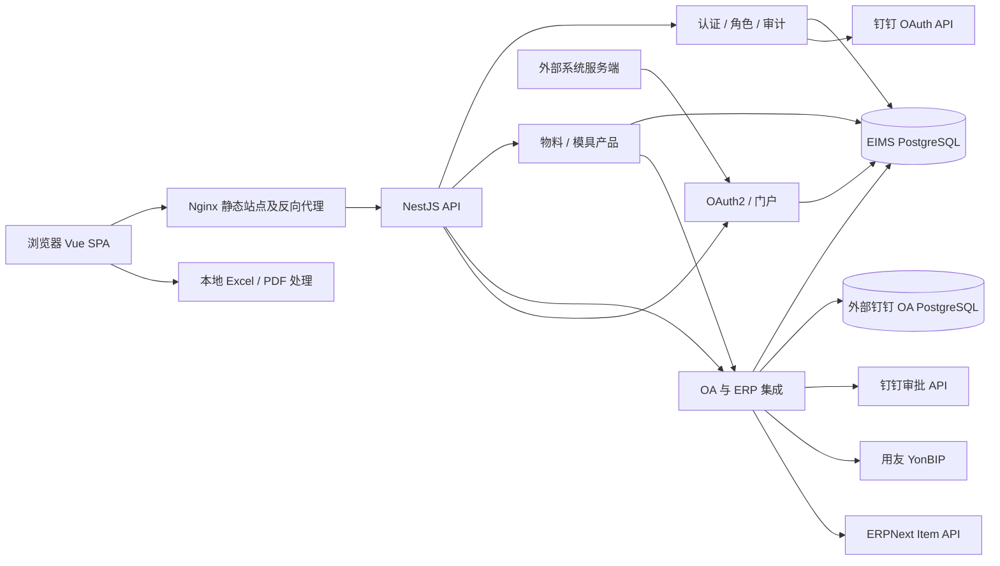

# 系统架构

## 组件与数据流

依据：[AppModule](../../backend/apps/api/src/app.module.ts)、[OaModule](../../backend/libs/oa/src/oa.module.ts)、[Compose](../../docker-compose.yml)、[箱贴页面](../../frontend/src/views/oa/box-label/index.vue)。箭头表示依赖／请求方向，不表示跨系统事务。

## 后端边界

| 层次 | 职责 | 代码入口 |
| --- | --- | --- |
| 应用装配 | 注册模块、调度器、全局 JWT → CSRF → 限流守卫、响应／审计拦截器和异常过滤器 | [AppModule](../../backend/apps/api/src/app.module.ts) |
| HTTP 入口 | Controller 路由、DTO、方法权限；只对有运行时 DTO 元数据的输入实施 class-validator 验证 | [main.ts](../../backend/apps/api/src/main.ts)、[API 总览](api-overview.md) |
| 业务层 | Service 编排查询、编码、事务、外部请求 | [模块索引](README.md) |
| 数据访问 | 全局 PrismaService，外部 OA 数据另用 pg Pool | [PrismaService](../../backend/libs/database/src/prisma.service.ts)、[OA 数据服务](../../backend/libs/oa/src/dingtalk-oa-db/dingtalk-oa-db.service.ts) |
| 公共协议 | `@Public()`、`@RawResponse()`、统一异常与分页 | [common](../../backend/libs/common/src) |

`material` 和 `mold-product` 复用 `oa` 导出的 ErpNextService，不能把 OA 库理解为仅服务审批页面。`roles` 是功能授权和门户角色计算的公共依赖；`user` 修改密码调用 AuthService 撤销 EIMS 会话。

## 前端边界与可复用入口

- 页面在 `views`，请求在 `service/api`，API 类型在 `typings/api`，业务状态保存在 Pinia；[request](../../frontend/src/service/request/index.ts) 统一 Cookie、CSRF、业务码处理。
- [静态路由](../../frontend/src/router/elegant/routes.ts) 定义权限键；[路由过滤](../../frontend/src/store/modules/route/shared.ts) 联合角色与功能权限裁剪菜单；[useAuth](../../frontend/src/hooks/business/auth.ts) 用于按钮权限。后端仍须校验权限。
- [表格 Hook](../../frontend/src/hooks/common/table.ts)、[表单 Hook](../../frontend/src/hooks/common/form.ts)、[Excel CRUD](../../frontend/src/utils/excel-crud.ts)、[Excel 读写](../../frontend/src/utils/excel-workbook.ts) 优先复用。
- `frontend/src/service/api/route.ts` 保留动态路由 API 调用，但当前后端未注册对应 `/route/*` Controller；不能将模板调用定义描述为已实现后端能力。

## 运行与一致性约束

定时任务与 HTTP 请求同在后端进程。当前应用装配未见 Redis、消息队列、持久化任务队列或对象存储模块。外部访问令牌、ERPNext 映射有进程内缓存；认证限流桶在数据库中共享。不能把进程布尔防重入当作多实例互斥。

本地事务只覆盖 EIMS 数据库。创建主数据后触发 ERPNext 异步同步，失败可记日志及人工重试；没有本地提交与远端写入的原子保证。详见[可靠性](reliability.md)和[集成关系](integrations.md)。
