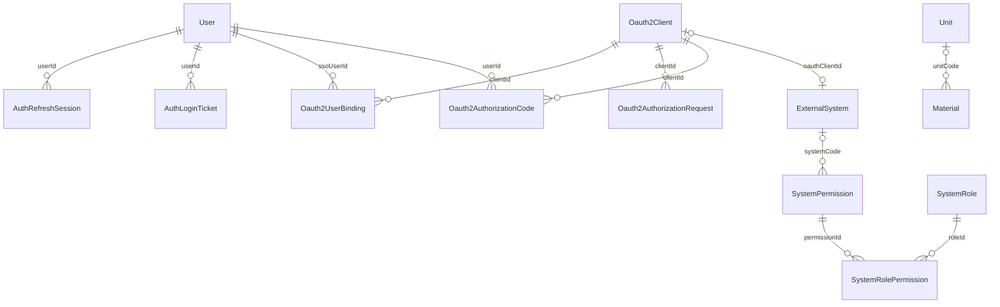

# 数据库总体设计

## 数据源与模型目录

主库使用 PostgreSQL，Prisma 从 `DATABASE_URL` 读取连接配置；模型、映射、索引以 [schema.prisma](../../backend/libs/database/prisma/schema.prisma) 为准。外部钉钉 OA 数据库通过独立 `DINGTALK_OA_DB_URL` 和 [pg Pool](../../backend/libs/oa/src/dingtalk-oa-db/dingtalk-oa-db.service.ts) 读取，不由 EIMS Prisma migrations 管理。

| Schema | 模型／表 | 用途 |
| --- | --- | --- |
| public | User → system_user；AuthLoginTicket、DingTalkOAuthState、AuthRefreshSession | 用户、一次性登录票据／state、浏览器会话 |
| public | Oauth2Client、Oauth2AuthorizationRequest、Oauth2AuthorizationCode、Oauth2AccessToken、Oauth2RefreshToken、Oauth2UserBinding | 客户端、授权事务、授权码、可撤销令牌与账号映射 |
| public | ExternalSystem、SystemRole、SystemPermission、SystemRolePermission | 门户目录、角色、权限、角色权限关联 |
| public | SecurityAuditLog、SecurityRateLimitBucket | 安全审计、数据库共享限流 |
| material | Material → materials、Unit → units、MaterialCodeRule → material_code_rules | 物料、单位、编码规则 |
| mold | PhoneCodeSequence、PhoneModel、Color、MoldMaterial → type、MoldCode、Mold、ProductCode、Product | 手机编码序列及模具产品主数据 |
| oa | OaMapping、DingEmployee、DingDepartment | 审批实例映射、员工与部门缓存 |
| oa | ErpSupplier、ErpMaterial、ErpUnit、ErpTax | 用友基础资料缓存 |
| oa | ErpNextMapping、ErpNextSyncLog | ERPNext 映射与同步结果 |

这些 Schema 是领域分组；模型没有统一 tenantId，也未见按租户自动过滤的 Prisma 扩展。组织名称、部门缓存、角色权限不能作为多租户隔离证明。

## 核心实体关系

下图仅画 Schema 中显式声明的外键，省略令牌等重复关系；“可空”以模型字段为准。

- 用户与 OAuth 客户端删除会级联清理关联会话／令牌／绑定；ExternalSystem 的客户端外键为 SetNull。系统删除时权限目录的 systemCode 为 SetNull。
- Material.unitCode 是可空外键，单位删除规则为 SetNull，但 UnitsService 先检查引用并拒绝常规删除。
- `User.roles`、`User.buttons`、`ExternalSystem.allowedRoles` 是字符串数组，不是角色外键；必须由服务验证有效编码。
- Mold／Product 保存手机、编码、颜色等冗余字段，Schema 未声明这些业务字段的外键。它们是应用层关联，不能在 ER 图中当作数据库强约束。
- OaMapping 等缓存无跨数据库外键；外部记录的真实存在性与新鲜度依赖同步。

## 约束与事务

- 用户名、钉钉 unionId／userId、客户端 ID、物料 code、模具／产品 itemCode 等设唯一约束。
- Mold 另有 `(moldCode, phoneCode)` 唯一约束；Product 为 `(productCode, phoneCode, colorCode)`；ProductCode 为 `(productCode, colorCode)`。
- OAuth 绑定同时唯一约束 `(ssoUserId, clientId)` 和 `(clientId, appUserId)`，防止同客户端重复绑定两端身份。
- 角色权限使用复合主键；ERPNext 映射唯一键为 `(type, sourceKey)`；同步日志没有业务对象唯一键，允许多次尝试留痕。
- ErpTax.rateValue 为 Decimal(10,4)；OA 推单金额计算当前使用 JavaScript number，不因缓存字段使用 Decimal 就具备财务精度保证。
- 事务、条件更新、序列行锁和不受事务保护的边界见[可靠性](reliability.md)及模块文档。

## 迁移与兼容性

[migrations](../../backend/libs/database/prisma/migrations) 保存 SQL 历史；[seed.ts](../../backend/libs/database/prisma/seed.ts) 维护基础种子。新字段须同时检查 Schema、DTO、API 类型、页面、导入导出与历史数据。

多词列必须 `@map("snake_case")`，模型必须 `@@map()`、`@@schema()`；保留历史单复数命名，如 `system_user`、`type`，不借文档统一表名。列重命名不能依赖 Prisma 推测，应保留数据编写 `ALTER TABLE ... RENAME COLUMN` 迁移；禁止用 `db push` 替代正式迁移。

历史兼容示例：[早期重命名迁移](../../backend/libs/database/prisma/migrations/20260625000000_rename_mold_material_to_type/migration.sql) 已保留为 `SELECT 1` 空操作，注释说明实际重命名应位于建表之后。不要仅凭目录名判断 SQL 行为。完整从零建库和存量升级均待授权环境验证，本轮没有连接数据库或执行迁移。
