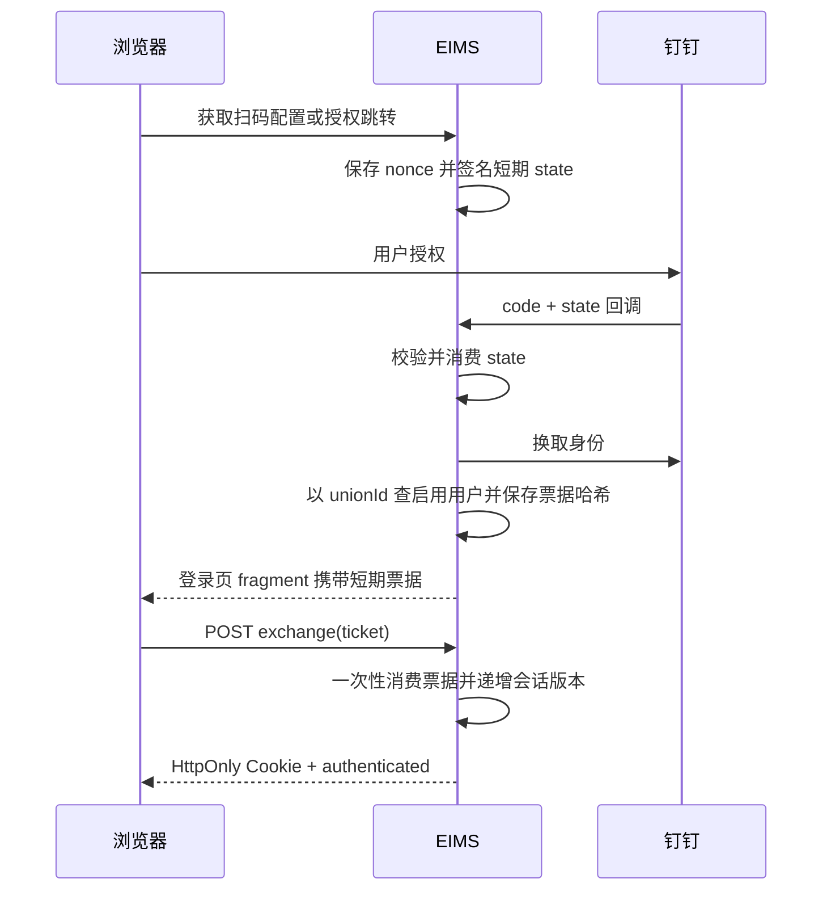

# 身份、角色、权限与安全审计

[返回知识库](../../knowledge/README.md)。本模块汇集 auth、user、roles、audit 四个相互依赖的 Nest 库；通用认证协议以[认证与权限](../../knowledge/authentication.md)为主，避免重复维护。

## 代码与接口

| 入口 | 页面／请求 | 后端与用途 |
| --- | --- | --- |
| 登录 | [内置登录](../../../frontend/src/views/_builtin/login/index.vue)、[auth.ts](../../../frontend/src/service/api/auth.ts) | [AuthController](../../../backend/libs/auth/src/auth.controller.ts)：POST `/auth/login`、`refreshToken`、`logout`，GET `/auth/getUserInfo` |
| 钉钉登录 | 登录页扫码／完整授权页 | GET `/auth/dingtalk/qr-config`、`authorize`、`callback`，POST `/auth/dingtalk/exchange` |
| 用户 | [system/access/user](../../../frontend/src/views/system/access/user/index.vue)、[user.ts](../../../frontend/src/service/api/user.ts) | [UserController](../../../backend/libs/user/src/user.controller.ts)：GET `/user/page`、GET `/:id`、POST 根、PUT／DELETE `/:id` |
| 角色 | [system/access/role](../../../frontend/src/views/system/access/role/index.vue)、[role.ts](../../../frontend/src/service/api/role.ts) | [RoleController](../../../backend/libs/roles/src/role.controller.ts)：GET `/roles`、`options`、`catalog`、`:id`；POST 根；PUT `:id`、`:id/access`；DELETE `:id` |
| 功能目录 | [system/access/permission](../../../frontend/src/views/system/access/permission/index.vue) | [PermissionController](../../../backend/libs/roles/src/permission.controller.ts)：GET `/permissions`、`:id`；POST 根；PUT／DELETE `:id` |
| 审计 | [system/operations/audit](../../../frontend/src/views/system/operations/audit/index.vue)、[audit.ts](../../../frontend/src/service/api/audit.ts) | [AuditController](../../../backend/libs/audit/src/audit.controller.ts)：GET `/audit/security`，按 event／result 分页 |

用户／角色／权限／审计管理入口同时使用 AdminGuard 和 PermissionGuard；角色 options／catalog 仍属于角色管理入口，不能默认视为任意登录用户都可调用。模型包括 User、SystemRole、SystemPermission、SystemRolePermission、认证票据／会话和 SecurityAuditLog。

## 主要业务规则

- [UserService](../../../backend/libs/user/src/user.service.ts) 对列表／详情采用字段选择排除 password。普通管理员不能给用户授予 R_SUPER，也不能更新或删除已有超级管理员；修改密码后撤销其 EIMS 会话。
- [RoleService](../../../backend/libs/roles/src/role.service.ts) 校验启用角色编码；内置角色只能由 R_SUPER 修改，R_SUPER 角色不能停用。删除角色前检查用户 roles 和门户 allowedRoles 的引用。
- `updateAccess()` 在事务内更新系统 allowedRoles 和角色权限关联；未提交的 systemCodes／permissionCodes 分支保持原值。其实现读全量门户并改数组，多管理员并发是否丢失相互授权需验证。
- 权限目录 `parentCode`、`routePath` 为描述字段，不等于自动注册后端路由；实际保护来自 Controller 装饰器。User.buttons 与计算出的 permissions 分开返回，不能混为一个权限源。

## 钉钉登录与自动账号

依据：[DingTalkOAuthService](../../../backend/libs/auth/src/dingtalk-oauth.service.ts)、[AuthService](../../../backend/libs/auth/src/auth.service.ts)。state 为 10 分钟，登录票据为 60 秒。userId／openId 不作 unionId 缺失时的登录回退。

自动账号来自 [DingtalkSyncService](../../../backend/libs/oa/src/dingtalk-sync/dingtalk-sync.service.ts)，由独立同步任务执行，并非登录回调任意建号：新账号 `ding_<userId>`、随机 bcrypt 密码、R_USER；既有账号保留密码和权限，更新身份映射，冲突不自动覆盖。离职／快照缺失不自动禁用，本地账号生命周期待业务方明确。

## 审计与清理

[AuditInterceptor](../../../backend/libs/audit/src/audit.interceptor.ts) 记录用户、角色、权限、门户管理、OAuth 客户端与绑定的写操作方法／路径；认证、OAuth、门户启动在各 Controller 显式记录。并非全业务流水；守卫拒绝发生在拦截器前，不能宣称所有拒绝均被该拦截器记录。

[AuditService](../../../backend/libs/audit/src/audit.service.ts) 屏蔽已列举的凭据键，限制字段长度，使用代理校验后的 request.ip；不写请求体。审计失败只打日志，不回滚主流程。

[SecurityCleanupService](../../../backend/libs/audit/src/security-cleanup.service.ts) 每 10 分钟清理过期安全记录；已消费记录另有 24 小时条件，已撤销令牌另有 30 天条件，审计保留约 180 天。实际 SQL 条件为 OR，已过期记录可更早删除。配置化保留策略、备份与合规要求待验证。
