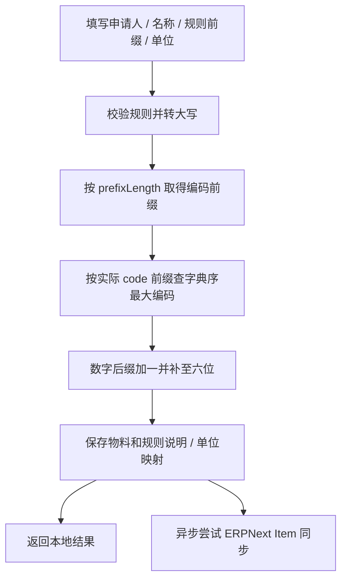

# 物料、单位与编码规则

[返回知识库](../../knowledge/README.md)。验证状态：已通过代码静态确认；并发及外部同步效果待实际环境验证。

## 定位与代码映射

| 功能 | 前端页面／请求 | 后端 Controller／Service | 模型 |
| --- | --- | --- | --- |
| 物料 | [material/material](../../../frontend/src/views/material/material/index.vue)、[material.ts](../../../frontend/src/service/api/material.ts) | [materials.controller.ts](../../../backend/libs/material/src/materials/materials.controller.ts)、[MaterialsService](../../../backend/libs/material/src/materials/materials.service.ts) | material.materials |
| 单位 | [material/unit](../../../frontend/src/views/material/unit/index.vue)、[unit.ts](../../../frontend/src/service/api/unit.ts) | [units](../../../backend/libs/material/src/units) | material.units |
| 规则 | [material/code-rule](../../../frontend/src/views/material/code-rule/index.vue)、[code-rule.ts](../../../frontend/src/service/api/code-rule.ts) | [code-rules](../../../backend/libs/material/src/code-rules) | material.material_code_rules |

使用者需对应 `eims:material:material`、`unit`、`code-rule` 权限；新增、修改、删除、导入、同步各有方法级权限。数据库细节见[字典](../../knowledge/data-dictionary.md)。

## 核心规则与流程

- `generateCode()` 查询 `code startsWith prefix`，不按可空 codePrefix 元数据找最大值，因此可纳入历史／ERP 编码；算法基于字符串倒序和 parseInt，假定后缀可解析且宽度符合约定。不是通用数值 MAX，也没有数据库锁或冲突重试。
- `previewCodes()` 和 `batchCreate()` 复用 generateBatchCode；同请求用 Map 记录各前缀下一号。预览不写数据库、不占号；最终提交可与预览不同。
- `update()` 只要提交非空 codePrefix 就重新生成 code，即使前缀与原值相同；更改单位名称时查字典并更新 unitCode。更新／删除未触发 ERPNext 对应改删。
- 新建单位码由 DTO 输入；单位编码不允许更新。删除单位先检查 Material 引用；名称变更不自动刷新历史物料的 unit 文本。
- 规则说明更新用事务同步相同 codePrefix 的 Material.explainContent；删除规则会在事务内清空这些说明，再删规则，不删除物料或自动改编码。

## 接口与输入

路径均为内部路径，浏览器通过 `/api` 代理；普通响应包装见 [API 总览](../../knowledge/api-overview.md)。

| 方法／路径 | 用途与关键契约 |
| --- | --- |
| GET `/material/page`、GET `/material/:id` | 分页筛选申请人、名称、编码、前缀、单位；详情 |
| POST `/material`、PUT `/material/:id`、DELETE `/material/:id` | 创建、修改、删除；字段见 [materials/dto](../../../backend/libs/material/src/materials/dto) |
| POST `/material/preview-codes` | `{prefixes:string[]}` → `{codes:(string|null)[]}`，不认识的规则对应 null |
| POST `/material/import` | `{rows:[...]}` 自动生成编码，返回 success／failed／errors |
| POST `/material/import-existing` | 数组行已有 code，保留原编码；返回 created／skipped／failed／errors |
| GET `/material/lookup/:code` | 先本地，后 ERPNext；返回 source=local／erp 与 data；均未找到抛 404 |
| POST `/material/sync-from-erp` | ERPNext 每页 200 拉取，已有码跳过，本地缺失逐条创建 |
| GET `/unit/page`、GET `/unit/:unitCode`、POST `/unit`、PUT／DELETE `/unit/:unitCode` | 单位字典 |
| GET `/material-code-rule/page`、GET `/material-code-rule/:codePrefix`、POST `/material-code-rule`、PUT／DELETE `/material-code-rule/:codePrefix` | 编码规则 |

业务主键和必填校验以各 DTO 为准；import-existing 使用 TypeScript interface 数组，不等于自动逐行 class-validator 校验。未找到抛 NotFoundException；单位被引用抛 ConflictException；其他 Prisma 错误是否被业务化处理依具体路径，不能统一宣称都返回 409。

## 导入与事务边界

- 自动编码导入先预检查规则／单位，然后对有效 toCreate 执行同一 `$transaction`。无效前缀跳过；未知单位仍保留文本、unitCode=null，并记 errors，因此 failed=errors.length 可能包含已创建行的单位警告，不能直接理解为失败行数。
- 已有编码导入按数据库已存在编码过滤，逐条创建，单行失败不回滚其他行；同一文件重复新码会触发唯一键，不能把它描述为全批幂等。
- ERP 拉取创建 applicant=ERP_SYNC，已有编码导入默认 applicant=IMPORT；两者可能没有 codePrefix／unitCode。后续生成编码应考虑这些历史记录。
- 自动创建后异步触发 ERPNext；同步失败不撤销本地物料。可靠性、规模与 DTO 边界见[问题清单](../../knowledge/reliability.md)。

前端通用 Excel 实现复用 [excel-crud.ts](../../../frontend/src/utils/excel-crud.ts)，该页还包含专用导入器；新增表头需保留内部键／旧别名并同步三语言。已有单测位于 [materials.service.spec.ts](../../../backend/libs/material/src/materials/materials.service.spec.ts)、units／code-rules 同目录 spec，本轮未执行。
