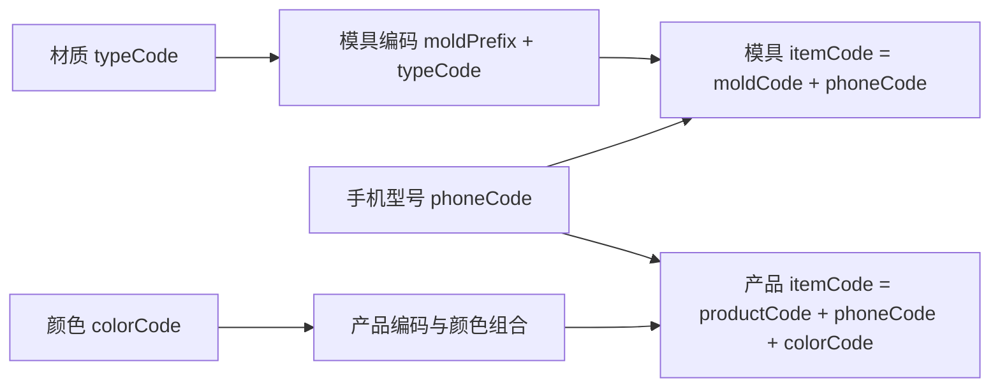

# 模具产品基础资料

[返回知识库](../../knowledge/README.md)。本模块管理品目主数据，不包含模具生产排程或库存流水。以下为已通过源码确认的行为。

## 代码及接口映射

前端页面统一位于 [views/mold-product](../../../frontend/src/views/mold-product)，API 定义位于 [service/api](../../../frontend/src/service/api)。下表每个后端目录都有对应 Controller／Service／DTO。

| 页面子目录 / API 文件 | 后端目录 | 内部路由前缀 | 模型 |
| --- | --- | --- | --- |
| phone-model / phone-model.ts | [phone-models](../../../backend/libs/mold-product/src/phone-models) | `/mold-product/phone-models` | PhoneModel、PhoneCodeSequence |
| color / color.ts | [colors](../../../backend/libs/mold-product/src/colors) | `/mold-product/colors` | Color |
| mold-material / mold-material.ts | [mold-materials](../../../backend/libs/mold-product/src/mold-materials) | `/mold-product/mold-materials` | MoldMaterial（mold.type） |
| mold-code / mold-code.ts | [mold-codes](../../../backend/libs/mold-product/src/mold-codes) | `/mold-product/mold-codes` | MoldCode |
| mold / mold.ts | [molds](../../../backend/libs/mold-product/src/molds) | `/mold-product/molds` | Mold |
| product-code / product-code.ts | [product-codes](../../../backend/libs/mold-product/src/product-codes) | `/mold-product/product-codes` | ProductCode |
| product / product.ts | [products](../../../backend/libs/mold-product/src/products) | `/mold-product/products` | Product |

通常提供 GET `prefix/page`、GET `prefix/:id`、POST `prefix`、PUT／DELETE `prefix/:id`；模具、产品另有 POST `prefix/import` 接收 `{rows}`；手机型号有 POST `prefix/batch-delete` 接收 ids。具体运行时字段约束以目录中 DTO 为准。方法权限为 `eims:mold:<领域>:<操作>`，读取使用对应领域权限，均由 PermissionGuard 实施。不要将前端目录单数直接拼成后端路径。

## 编码和业务规则

- 手机编码从 id=1 序列表取值并补至四位；独立生成方法在事务里 FOR UPDATE。按全称查找用唯一键；按简称先 findFirst，再按全称回退，再创建。简称非唯一，不能假设简称一对一。
- 模具编码由 moldPrefix + 材质 typeCode 转大写；模具创建以 moldCode 找模板，自动查找／创建手机型号，再拼 itemCode。单次创建和修改在事务中。
- 产品创建按 productType 找出**全部** ProductCode 记录，为每条颜色组合生成产品，返回数组；产品修改变更 productType 时使用 findFirst 更新单条，不等同于重新展开所有颜色。
- Mold／Product 保留名称等快照字段；基础字典改名不会自动传播到所有下游。数据库联合唯一键和应用校验共同限制重复，业务关联不全是外键。
- 手机删除检查模具和产品；材质、模具编码、产品编码的改码／删除也有引用检查，但检查维度不完全相同。颜色改码检查 ProductCode 与 Product，删除只检查 Product，需注意遗漏上游引用的边界。

依据：[PhoneModelsService](../../../backend/libs/mold-product/src/phone-models/phone-models.service.ts)、[MoldCodesService](../../../backend/libs/mold-product/src/mold-codes/mold-codes.service.ts)、[MoldsService](../../../backend/libs/mold-product/src/molds/molds.service.ts)、[ProductsService](../../../backend/libs/mold-product/src/products/products.service.ts)、[ColorsService](../../../backend/libs/mold-product/src/colors/colors.service.ts)。约束详见[数据库](../../knowledge/database.md)。

## 批量导入、失败与同步

| 入口 | 实际事务范围／返回口径 |
| --- | --- |
| 模具导入 | 预处理逐行查模板、创建手机和查重；最终模具插入统一事务。预处理创建的手机不随最终模具失败回滚；同批重复 itemCode 可能导致最终整批写入失败 |
| 产品导入 | 逐行调用 create，每行展开的产品在该行事务中；其他行可继续。success 为创建的产品条数，failed 为错误输入行数，不一定相加等于输入行数 |
| 手机批量删除 | 逐项引用检查和删除，允许部分成功；返回 deleted／failed／errors |

创建成功后异步同步 ERPNext；更新和删除没有对等远端同步。ProductsService.batchCreate 既通过 create 触发逐行同步，又在结尾 syncProducts，存在重复远端尝试；远端重复 Item 会按 SKIPPED 记日志。手机自动创建方法若传 null 使用普通 Prisma client，FOR UPDATE 与更新不保证处于同一事务；该路径出现在模具导入预处理。以上作为[可靠性事项](../../knowledge/reliability.md)记录，未修改实现或运行并发测试。

公共 Prisma 冲突翻译见 [helpers.ts](../../../backend/libs/mold-product/src/helpers.ts)。导入模板／导出继续复用 Excel 公共工具和三语言资源，名称数据本身并未自动多语言化。
