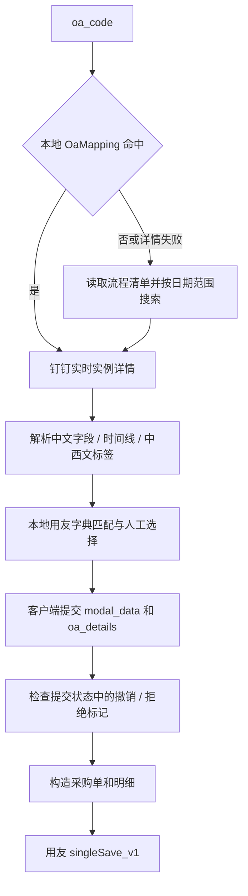
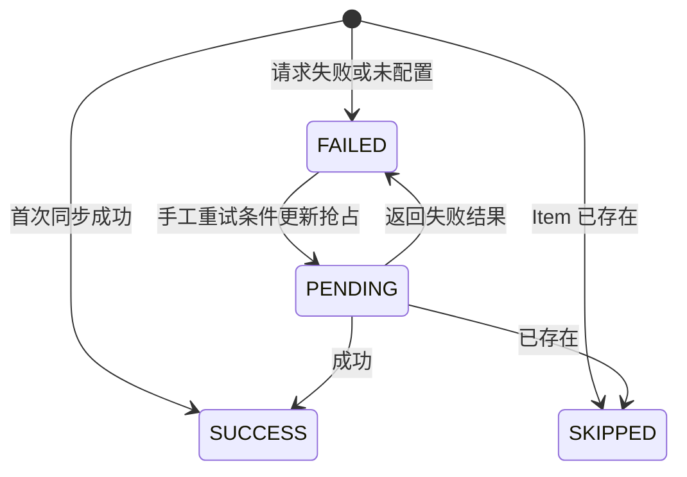

# OA 审批与 ERP 集成

[返回知识库](../../knowledge/README.md)。Nest OaModule 同时承载审批、用友缓存和 ERPNext Item 同步；后两者不是同一个 ERP 通道。

## 页面、接口与数据

| 功能 | 前端 | 后端／接口 | 本地模型 |
| --- | --- | --- | --- |
| 审批查询／推单 | [oa/approval](../../../frontend/src/views/oa/approval/index.vue)、[oa.ts](../../../frontend/src/service/api/oa.ts) | [oa-approval](../../../backend/libs/oa/src/oa-approval)：POST `/oa/approval/detail`、`check-cache`、`sync-erp` | OaMapping |
| 匹配搜索 | 审批页选择框 | [oa-search](../../../backend/libs/oa/src/oa-search)：GET `/oa/search/material`、supplier、unit、tax | ErpMaterial、ErpSupplier、ErpUnit、ErpTax |
| 映射维护 | [erpnext-mapping](../../../frontend/src/views/mold-product/erpnext-mapping/index.vue) | [erpnext-mapping](../../../backend/libs/oa/src/erpnext-mapping)：GET `/erpnext-mapping/page`、GET `/:id`、POST 根路径、PUT／DELETE `/:id` | ErpNextMapping |
| 同步日志／重试 | [erpnext-sync-log](../../../frontend/src/views/system/operations/erpnext-sync-log/index.vue) | [erpnext-sync-log](../../../backend/libs/oa/src/erpnext-sync-log)：GET `/erpnext-sync-log/page`、GET `/:id`、POST `/:id/retry` | ErpNextSyncLog |
| 后台快照 | 无专属页面 | [dingtalk-sync](../../../backend/libs/oa/src/dingtalk-sync/dingtalk-sync.service.ts)、[erp-sync](../../../backend/libs/oa/src/erp-sync/erp-sync.service.ts) | DingEmployee、DingDepartment、OaMapping、ERP 缓存 |

审批读取和搜索需 `eims:oa:approval`，推单需 `eims:oa:approval:sync`；映射使用 `eims:mold:erpnext-mapping`，日志使用 `eims:system:erpnext-sync-log` 及各操作权限。请求／响应保留历史 snake_case 和中文表单键，字段来源见各目录 DTO、[ERP 接口类型](../../../backend/libs/oa/src/erp/erp.interface.ts)。

## 审批查找与用友推单

- detail／check-cache 输入为 `{oa_code}`。命中缓存仍调用钉钉详情；全流程搜索尝试从审批号首八位确定前后两天，否则最近一年。流程清单从代码拼接的旧 `EIMS-System/backend/oa/all_forms_list.txt` 路径读取，缺失则返回空清单并告警；本仓库未提供该清单，缓存未命中回退待验证。
- [MaterialMatcher](../../../backend/libs/oa/src/helpers/material-matcher.ts) 解析员工部门、匹配供应商／物料／单位／税率；搜索各有 take 限制，不是全量返回。物料名称模糊匹配存在多条时返回未匹配，但推单取码仍可能使用固定回退物料 `RC000079`；供应商未匹配回退 `GYS00029`、单位回退 `06`、税码回退 `VATR1`。这些是现有业务代码常量，不表示已确认适用于所有单据，实际业务含义与是否允许回退待确认。
- sync-erp 接收 `{modal_data, oa_details}`。当前只拒绝提交状态包含 CANCELLED／REJECTED 或撤销／拒绝中文的情形，未重新获取权威状态，也不要求显式“审批完成且同意”。
- 推单从首个可识别表格字段提取明细，按中／西混合标签识别数量、价格、金额；无明细拒绝。组织代码由 dto.org 的中文名称分支确定，币种固定 CNY、汇率 1；金额 parseFloat，非法数值归零。
- ErpService 将远端结果转为 `{code:'success'|'error',...}`，外面仍会套普通 API 成功包装。调用方必须判断内层结果。
- 当前未见按审批编号的推单唯一约束、本地已推送流水或防重复请求键。发生超时后远端是否已创建需人工核对，不能直接认定未写入或自动重试。

依据：[OaApprovalService](../../../backend/libs/oa/src/oa-approval/oa-approval.service.ts)、[ErpService](../../../backend/libs/oa/src/erp/erp.service.ts)。这些是现有实现，不是已认可的审批／财务完整性规则。

## ERPNext Item、映射和恢复

[ErpNextService](../../../backend/libs/oa/src/erpnext/erpnext.service.ts) 接收物料／模具／产品数据，构造 Item payload。映射类型为 ITEM_GROUP、MOLD_ITEM_GROUP、PRODUCT_ITEM_GROUP、UNIT；缺映射采用代码常量回退。映射 CRUD 后重载当前进程缓存，不是分布式失效。

创建 Item 30 秒超时；查询单个 15 秒、分页查询 30 秒。HTTP 409／already exists／DuplicateEntryError 视为成功跳过，不比较远端字段。日志记录请求、结果及重试次数；未配置凭据时 success=false，最终写 FAILED。

[重试服务](../../../backend/libs/oa/src/erpnext-sync-log/erpnext-sync-log.service.ts) 使用原日志 requestPayload，禁止对 SUCCESS／SKIPPED 重试，抢占 PENDING 后调用 createItem(skipLog=true)，更新同一日志。条件更新降低同时重试风险，但没有超时 PENDING 自动恢复；进程崩溃或数据库写失败可能需人工处理。同步日志写入为尽力而为，不是事务 outbox。

外部数据源、自动账号、调度频率、责任边界统一见[集成关系](../../knowledge/integrations.md)。重要风险与验证方向集中在[可靠性清单](../../knowledge/reliability.md)，不在本轮修复。
