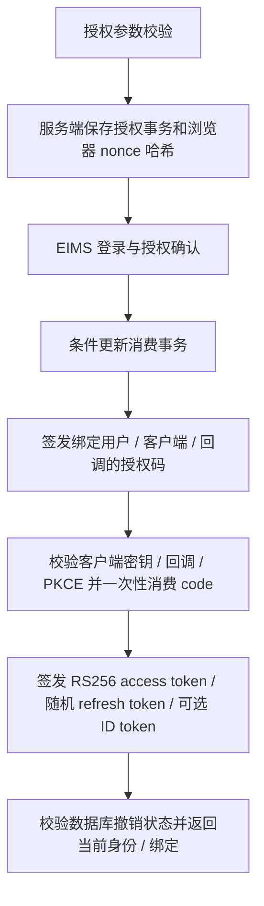

# OAuth2／OIDC Provider 与账号绑定

[返回知识库](../../knowledge/README.md)。EIMS 管理统一身份和外部账号映射，外部系统负责自身会话、用户状态、角色与数据权限。对接参数复用[实施规范](../../eims-sso-integration-guide.md)、[协议参考](../../oauth2-sso-integration.md)，本页说明代码边界。

## 管理入口和模型

| 入口 | 前端页面／请求 | 后端 |
| --- | --- | --- |
| 客户端 | [oauth2-client](../../../frontend/src/views/system/sso/oauth2-client/index.vue)、[API](../../../frontend/src/service/api/oauth2-client.ts) | [OAuth2ClientController](../../../backend/libs/oauth2-provider/src/oauth2-client.controller.ts)：GET `/oauth2/clients`、`:id`；POST 根；PUT／DELETE `:id`；POST `:id/reset-secret` |
| 绑定 | [oauth2-binding](../../../frontend/src/views/system/sso/oauth2-binding/index.vue)、[API](../../../frontend/src/service/api/oauth2-binding.ts) | [OAuth2BindingController](../../../backend/libs/oauth2-provider/src/oauth2-binding.controller.ts)：GET `/oauth2/bindings/users`、根列表；POST 根；PUT／DELETE `:id` |
| 授权页 | [oauth2-authorize.ts](../../../frontend/src/service/api/oauth2-authorize.ts)、登录 oauth-consent 模块 | [OAuth2Controller](../../../backend/libs/oauth2-provider/src/oauth2.controller.ts) |

管理 API 同时要求 AdminGuard 与 `eims:system:oauth2-client`／`oauth2-binding` 的具体权限。模型为 public 下 Oauth2Client、AuthorizationRequest、AuthorizationCode、AccessToken、RefreshToken、UserBinding，字段与约束见[数据字典](../../knowledge/data-dictionary.md)。

- [客户端服务](../../../backend/libs/oauth2-provider/src/oauth2-client.service.ts) 生成随机 clientId／secret，数据库保存 bcrypt 哈希；列表详情不返回哈希，创建／重置仅返回本次明文。回调地址精确白名单，scope 校验沿用现有 DTO／Service。
- [绑定服务](../../../backend/libs/oauth2-provider/src/oauth2-binding.service.ts) 检查 EIMS 用户／客户端存在；appUserId 去首尾空白后保留字符串。数据库保留 `(ssoUserId, clientId)` 唯一约束，P2002 转冲突；`(clientId, appUserId)` 改为普通索引，允许多人共享外部账号。更新不改变所属 EIMS 用户和客户端。
- 新增或更换账号时，如果已存在同应用、同 appUserId 的绑定且未确认，返回 HTTP 409，普通错误包装的 `msg` 为稳定标识 `OAUTH2_SHARED_ACCOUNT_CONFIRMATION_REQUIRED`，此次不写入。页面使用三语确认框提示共享权限／操作归属；取消不保存，确认后以相同参数和 `confirmSharedAccount: true` 再提交一次。未变更账号、仅编辑显示名称时不重复提示。提示是对当前已存在绑定的检查，不是排他锁；同时首次绑定同一空闲账号时可能均未看到共享提示，但共享本身是允许的业务行为。
- [迁移脚本](../../../backend/libs/database/prisma/migrations/20261019090000_allow_shared_oauth2_accounts/migration.sql) 在事务中将外部账号唯一索引替换为普通索引，不删除绑定数据。发布需协调数据库迁移、后端和前端版本；迁移未执行时仍无法保存重复外部账号。回滚前须人工处理共享绑定，不能直接恢复唯一索引或任意删除用户绑定。本次未执行数据库迁移。
- 绑定只存外部用户 ID／用户名，不存外部角色或密码。删除／更换绑定没有向外部系统发送会话撤销通知。

## 协议端点与授权流程

| 方法／端点 | 请求／返回要点 |
| --- | --- |
| GET `/oauth/authorize` | client_id、redirect_uri、response_type=code、scope、state、PKCE、可选 nonce；校验后跳转 EIMS 授权页 |
| GET `/oauth/authorize/transaction` | 已登录 + transaction_id + 对应浏览器 Cookie；返回安全展示信息 |
| POST `/oauth/authorize/confirm` | transaction_id、consent；Cookie／CSRF；返回普通包装的 redirectUrl |
| POST `/oauth/token` | code 换取或 refresh_token 轮换；客户端 Basic 或 body 身份；协议原始 JSON |
| GET `/oauth/userinfo` | Bearer OAuth access token；按 scope 返回身份及当前账号映射 |
| POST `/oauth/revoke` | 客户端身份 + token；原始空对象；无显式 HttpCode，当前框架默认成功 HTTP 201 |
| GET `/oauth/logout` | 可选 id_token_hint、client_id、已注册 post_logout_redirect_uri、state；跳转 |
| GET `/oauth/.well-known/openid-configuration`、`/oauth/jwks` | Discovery、RS256 公钥；协议原始 JSON |

依据：[OAuth2Service](../../../backend/libs/oauth2-provider/src/oauth2.service.ts)、[OpenIdService](../../../backend/libs/oauth2-provider/src/openid.service.ts)。当前只支持 authorization_code 和 refresh_token，不是任意 OAuth grant 实现。

## 安全、一致性与权限边界

- 新客户端 pkceRequired=true；兼容客户端可关闭强制提交，但提交 PKCE 时仍只接受 S256 并验证 verifier。state 必须非空，授权事务浏览器 Cookie 防止替换／跨浏览器确认。
- 授权事务／授权码通过 consumedAt 条件更新一次性消费；消费和后续发码／签发令牌不构成完整单事务，后续失败应重新授权，不把旧 code 重用作恢复。
- OAuth 访问令牌、刷新令牌均有哈希记录、撤销状态和 familyId；刷新令牌轮换，重放撤销该族。当前刷新响应不返回新的 id_token，客户端应保存授权码交换时的 ID token。
- 如果客户端关联 ExternalSystem，授权／令牌相关访问检查会校验系统启用、oauth2 模式、启用用户角色、allowedRoles 和账号绑定；R_SUPER 可绕过角色列表，但仍需绑定。未关联门户的客户端保留原策略，不能将门户限制推广到所有客户端。
- UserInfo 的 app_user_id 对应当前客户端；角色不下发。外部系统还必须检查本地账号可用性。
- 共享账号仍按各自 EIMS 用户签发 OAuth 身份（sub），UserInfo 可返回相同 app_user_id。外部系统若按该账号建立会话，权限与操作记录可能合并归属；需分别用两个 EIMS 用户联调，确认外部系统没有单一 sub 绑定限制。现有本地会话不会因新增共享绑定而自动重建。
- `/oauth/logout` 撤销用户 EIMS 会话，并根据 clientId 撤销相关 OAuth 访问／刷新令牌；没有 clientId 时范围更广。它不是对所有外部系统的后端登出广播。外部系统必须自行清理本地会话。
- RSA 密钥由文件持久化，公钥构成稳定 kid；多实例必须一致管理密钥。当前没有自动多密钥轮换编排，运维验证见[部署](../../knowledge/deployment.md)。

现有 OAuth Controller、access-policy、binding 等 spec 是可复用验证入口。前端共享确认流程测试位于 `frontend/tests/oauth2-binding.test.ts`。Mock 单测不能替代数据库迁移和真实客户端验收；跨浏览器、多标签刷新、重放和真实客户端联调仍待验证。
