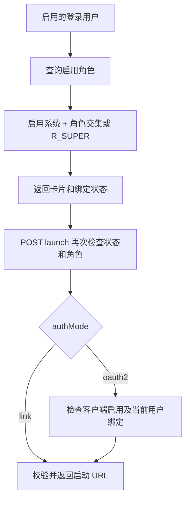

# 统一门户与外部系统目录

[返回知识库](../../knowledge/README.md)。使用说明复用[门户专题](../../portal-system-center.md)，本页记录后端策略及代码映射。

## 代码和接口

- 首页：[home/index.vue](../../../frontend/src/views/home/index.vue)；管理页：[system/sso/external-system](../../../frontend/src/views/system/sso/external-system/index.vue)；请求：[portal.ts](../../../frontend/src/service/api/portal.ts)。
- [PortalController](../../../backend/libs/portal/src/portal.controller.ts)：GET `/portal/systems`、GET `/portal/me/permissions`、POST `/portal/systems/:code/launch`。
- [PortalAdminController](../../../backend/libs/portal/src/portal-admin.controller.ts)：GET／POST `/portal/admin/systems`，GET／PUT／DELETE `/:id`；AdminGuard + PermissionGuard。
- [ExternalSystemService](../../../backend/libs/portal/src/external-system.service.ts)：目录 CRUD、可见性、绑定状态、地址校验和启动。模型为 ExternalSystem，关联 Oauth2Client；权限和账号绑定共用 public 身份模型。

## 可见性与启动规则

- allowedRoles 空数组拒绝普通用户；代码没有“所有已登录用户”访问策略。启用的 R_SUPER 对角色名单有特例，但 OAuth2 系统仍检查客户端与账号绑定。
- 未绑定用户可看到其角色可见的系统卡片，canLaunch=false；可见不等于可启动。
- 列表不返回入口地址或密钥；启动结果包含经过后端校验的 URL、authMode、bindingStatus、映射信息。不能绕过 launch 直接使用旧静态 JSON 做权限决策。
- authMode=link 不持有 OAuth 客户端关联；从 oauth2 切到 link 时服务清空 oauthClientId，保留客户端与绑定记录，便于以后重新关联。
- 管理端的分页大小夹到 1～100；URL 禁止非允许协议、凭据等，production 要求 HTTP 类 URL 使用 HTTPS。

## 地址优先级

对 oauth2 模式：数据库非空 `ssoStartUrl` → 预置编码对应 `EXTERNAL_*_SSO_START_URL` → 有效入口地址。有效入口地址：预置编码的 `EXTERNAL_*_URL` → 数据库 entryUrl。

因此 SSO 启动地址与普通入口的环境覆盖顺序**不同**。SSO 启动 URL 指目标系统发起 OAuth 的服务端入口，不是回调地址。预置覆盖只作用于 budget／erp／mes／crm／lemos，自定义系统使用数据库配置。

## 边界与验证

EIMS 只控制门户及关联 OAuth 的身份／入口准入，外部业务系统必须自己校验权限。目录有系统记录不代表已联调上线。多角色配置、绑定变更后的外部既有会话、生产代理和实际启动地址均待实际环境验证；本轮只核对源码。已有 external-system.service.spec.ts 可作为后续验证入口。
